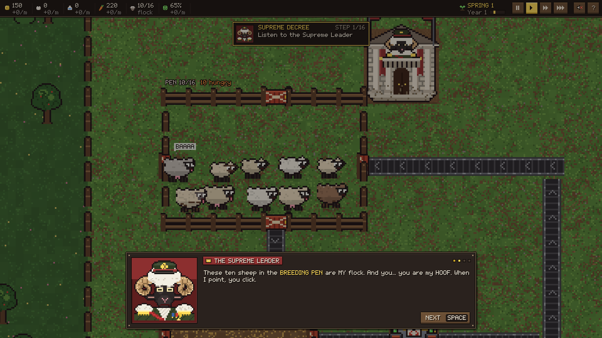
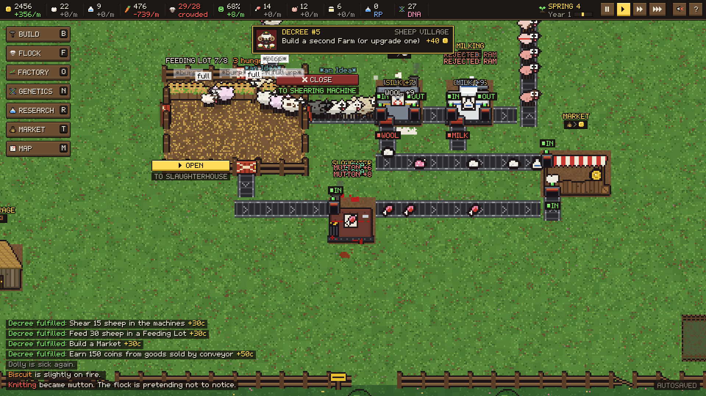
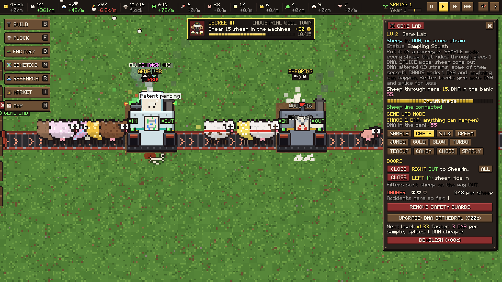
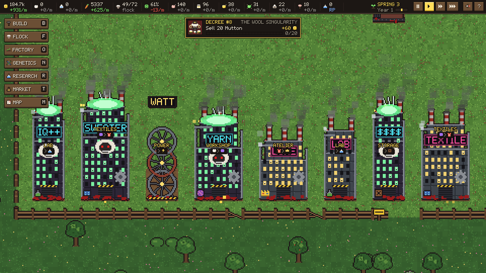

# SHEEPTATOR: A Sheep Management Tragedy

**A pixel-art factory sim made in Unity 6. The Supreme Leader is a sheep, and you are his Hoof.** You open the doors and send the flock riding conveyor belts into Shearing Machines, Milking Machines and the Slaughterhouse. You sell what comes out, breed more sheep, and grow a sad little field into a neon wool empire.

Every pixel, letter and sound in the game is generated by code at runtime. There are no imported assets.

| | |
|---|---|
|  |  |
|  |  |

---

## Gameplay

- **A sheep Factorio.** Sheep never work; they are managed. They live in **Breeding Pens**, eat in **Feeding Lots** and ride conveyors through machines:
  - shorn for wool;
  - milked for milk;
  - bred for lambs;
  - turned into mutton, or sold alive at a Market.
- **Rooms, doors and belts.** Every room has a door on each side. Open a door onto a belt and the sheep walk out one by one and ride to wherever it leads.
  - Shut doors, full rooms and dead ends make the line wait, and the Supreme Leader shouts about it.
  - With **Smart Doors** each door gets a filter (hungry, fed, fluffy, milky, rams, ewes…), and two open OUT doors split the line. Leave the doors open and the factory runs itself.
- **Genetics.** A Gene Lab on the line samples DNA and splices sheep into **13 strains**, from Silkfleece and Golden Fleece to Turbo, Teacup and six secret hybrids such as the Phoenix Sheep. CHAOS mode spins the wheel: mutations, a baby again, or a 5% KA-BOOM.
- **The Supreme Leader** is a big ram with an officer's cap and too many medals.
  - He runs a 16-decree tutorial with a pointing arrow and glowing blueprints.
  - He then sets goals with rewards, and shouts when something goes wrong.
- **Depth:**
  - 22 buildings with up to 5 levels each, from wooden shacks to neon skyscrapers;
  - a wool chain from wool to luxury goods, with fluctuating prices;
  - three belt tiers;
  - individual sheep with names, moods and 23 traits;
  - machine accidents, wolves and guard posts;
  - 20+ decision-card events (the vegetarian wolf Gerald, the Great Shears cult…);
  - 38 research projects ending in the Sheep Space Program;
  - seasons, land expansion and settlement tiers.

**Status:** a playable vertical slice of the design.
- Saves are versioned, and older saves keep loading.
- Balance has been checked with an automated bot playthrough over 70 in-game days.
- The Steam store page was built in October 2026 with capsules, library art, 15 screenshots and description GIFs. A trailer was cut too, but it isn't on the page.
- Still to come: real art and audio to replace the procedural placeholders, and balance testing with real players.

## Tech stack

| Area | What it uses |
|---|---|
| Engine | **Unity 6** (6000.0.32f1), 2D |
| Art | **Procedural pixel art** generated at runtime: sheep, buildings at every level, props, a pixel font, icons and the logo, drawn into textures and shown with sprite renderers |
| UI | An **immediate-mode pixel UI kit** with riveted panels, keycap buttons, cards, gauges and tooltips. The UI scale is always a whole number, so pixels stay crisp. |
| Audio | **Synthesized** baas and sound effects (`AudioClip.Create`) |
| Saving | JSON save/load of the whole world, with migrations from older save versions |
| Store page | Python tools that build the Steam capsules and library art from in-game exports (`storeart.py`, `pixfont.py`, `woollogo.py`), cut description GIFs, and assemble the trailer (`trailer.py`) with a synthesized chiptune march (`march.py`) |

## What I built

All of it. The game code is **`Assets/Fleeced/Scripts/`**: 28 C# files, about 14k lines. The code namespace keeps the game's earlier name, *Fleeced*.

| File | What it does |
|---|---|
| `Data/Defs.cs` | Traits, buildings, research and names: the main tuning file |
| `Core/Game.cs` | Boot, loop, time, camera and input |
| `Core/SheepSim.cs` | Sheep needs, behaviour, the mood formula, efficiency, death and visuals |
| `Core/Pens.cs` | Rooms and doors, door filters, breeding and feeding, the conveyor machines and their doors, line splitting, the Slaughterhouse |
| `Core/Belts.cs` | Conveyor belts, items, and sheep riding belts (queues, machine entry, pen drop) |
| `Core/BuildingSim.cs` | Construction, production chains, shearing, breeding and accidents |
| `Core/Genetics.cs` | DNA, the 13 strains and hybrid table, the Gene Lab's modes, side effects and inheritance |
| `Core/Economy.cs`, `Core/Events.cs` | The market, research, goals and tiers, event cards, wolves and the rocket launch |
| `Core/Leader.cs`, `Art/LeaderArt.cs` | The Supreme Leader: dialogue, tutorial decrees, blueprints, shouting, and his portrait and palace |
| `Core/SaveLoad.cs`, `Core/World.cs` | Saving and loading, ground tiles, grass, land and placement |
| `Art/*` | Procedural sprites, the pixel font, icons and the logo |
| `UI/*`, `Audio/Sfx.cs` | The pixel UI kit, the HUD and all panels, and the synthesized sound |

### Code highlights

- **`Core/Pens.cs` + `Core/Belts.cs`:** sheep are physical items on a conveyor network.
  - They queue at busy machines, shut doors and full rooms.
  - Machine OUT doors split a line round-robin, and filters route each sheep.
  - A blocked line waits in place rather than losing sheep.
- **`Core/Genetics.cs`:** a strain system with hidden hybrids. A lamb of two different strains can reveal a secret one. Splicing has side effects, and Phoenix Sheep are reborn.
- **`Art/BuildingArt.cs`:** every building drawn in code at each visual level, from wooden shack to rusty industrial with smokestacks to neon skyscraper.
- **`Core/Leader.cs`:** a tutorial that teaches by doing. Decrees unlock menus as he introduces them, and glowing blueprints show where things go. The belt tool auto-corrects its direction on planned tiles.
- **`Core/SaveLoad.cs`:** every save version still loads. For example, workers from version 6 turn back into livestock, and mid-tutorial saves pick up new lessons.

## Scenes

| Scene | Purpose |
|---|---|
| `Assets/Scenes/SampleScene.unity` | The game boots itself from `Core/Game.cs` via `[RuntimeInitializeOnLoadMethod]`, so any scene works. |

## Integrated third-party assets

None. All art, the font, the UI and the sound are generated by the game's own code.

## Docs

- [`FLEECED_README.md`](FLEECED_README.md): the full design notes, covering the core loop, every building and door rule, genetics, the tutorial, save versions and the code map
- `Steam/store/STORE_PAGE.md`: what was set up on Steamworks for the store page
- `Steam/store/src/`: art exported from the game, which `storeart.py` turns into the store capsules and library images
- `Screenshots/`: images captured from test builds

## About this repository

This public repository is a **showcase**. It contains the documentation and the **34 source files I wrote** for this project. The complete Unity project, with the store-page material and the Steam setup, is kept in a private repository.

Copyright © Omer Avcioglu (McHunter Studio). **All rights reserved.** Viewing only; see [LICENSE](LICENSE).
